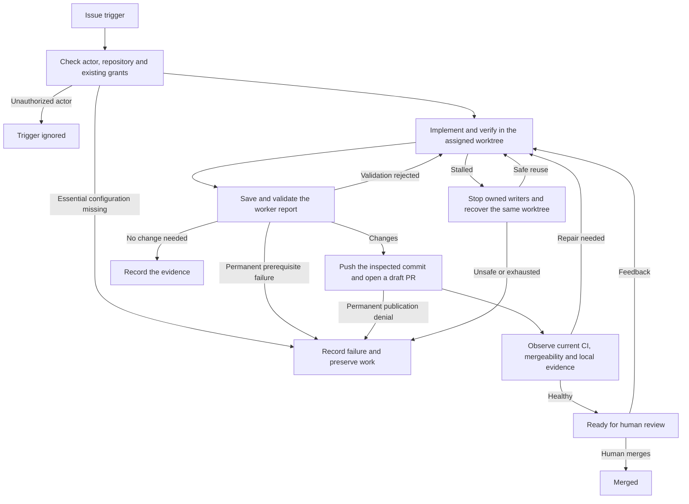

# GitHub issues to pull requests

## Problem

A team wants to hand a GitHub issue to an agent and get back a pull request that went through `/poteto-mode`. When a reviewer comments on that pull request, the same job continues the work. A person adds a label, reviews code, and merges. Nobody answers questions, retries a job, or rescues a worker thread.

pstack already runs rigorous work in a thread. Issue jobs add the parts a thread lacks: watching GitHub, owning a pull request across review rounds, recovering a stalled worker, and keeping GitHub credentials away from the agent.

The bb Plugin SDK and the deployment set these limits:

- Plugin server code and services run on the bb server machine. Threads and their worktrees run on enrolled hosts, usually other machines.
- `threads.spawn` has no idempotency key.
- A secret setting is stored in a 0600 file on the server and cannot be multi-line.
- The server can run code on a host only through the plugin's `bb.host` entry and typed host RPC. That API is experimental.
- `threads.stop` asks a thread to stop. It does not fence the worktree against other writers.
- A playbook checklist is created once per thread.

## What a job delivers

Every accepted trigger ends in one of these outcomes. The app, `bb pstack issues list` and `issues show`, and the issue's status comment all report it.

| Outcome | Meaning |
|---|---|
| Ready for review | A pull request whose current head passed observed CI, has clean mergeability, and carries the worker's local verification for that exact head and base. A person still reviews and merges it. |
| No change needed | The worker showed, with issue-specific evidence, that the issue needs no code change. |
| Failed | The job could not deliver. The reason is recorded, and the worker's commits and files stay in their worktree. |
| Closed without merging | Someone closed the pull request without merging it. This is not a success. |
| Merged | Someone merged the pull request. |
| Stopped | A person stopped the job. |

Ready for review is not merged. pstack never merges a pull request.

Delivery to GitHub is separate from the outcome. When the status comment, a label, a reply, or a review request cannot be written, the outcome stays as it is, and the delivery error is shown beside it and retried.

## Lifecycle overview



Every transition updates the desired issue status in the database. Independent delivery retries the issue comment and labels when GitHub recovers. A temporary outage keeps the accepted work and its pending effects. A permanent publication denial records failure without discarding the commit.

## Setup

A person does this once.

1. Create a GitHub App with webhooks off and these repository permissions:
   - Contents: read and write.
   - Pull requests: read and write.
   - Issues: read and write.
   - Checks: read.
   - Commit statuses: read.
   - Metadata: read.
   - Workflows: read and write. This is optional. Without it, a change under `.github/workflows` fails publication with its commits kept.
   - Administration: read. This is optional. It lets pstack read classic branch protection. A ready result carries a limitation when protected-branch policy cannot be read.
2. Install the App on the target repositories.
3. Configure pstack:

```sh
bb plugin config pstack set githubAppId 123456
bb plugin config pstack set githubPrivateKey "$(base64 -w0 app.private-key.pem)"   # secret
bb plugin config pstack set issueRepos "acme/web project=proj_abc host=host_def
acme/api project=proj_xyz"
```

Each `issueRepos` line maps one repository to the bb project that holds its checkout. `host=<hostId>` pins the repository's workers to one machine, which must not be the server machine. Without `host=`, or with `host=auto`, the service picks a machine for each job when the job starts.

pstack never asks for more permissions and never prompts for credentials. Before a job starts, pstack reads the installation's grants. An archived repository, a default branch that no longer matches the job's base, or missing contents or pull requests write fails the job before any worker starts.

## Choosing a machine

A pinned job copies its machine from `host=` when its row is inserted, and a sub-issue's job copies its parent's pin. For a pinned job, pstack checks the worker's `provider/model/level` against that machine's provider catalog before the start.

Each poll first resolves the worker the repository's next job would run: the first `issue worker` choice with the project's defaults, and for a pinned repository that machine's catalog. While that fails, or the catalog does not load, the poll creates no job. It records the reason as the repository's poll error, which `issues list` prints, keeps its label cursor so the skipped label events are read again once the worker can run, and still polls the open jobs. `bb pstack doctor` runs the same check once per pinned machine and tuple. A manual start or retry refuses with the same reason.

An automatic job has no machine until it starts. `pickHost` in `src/placement.ts` picks one from the same facts `bb pstack spawn` reads, through the shared `Placement` and its 30 s cache. A machine is eligible when it is connected and active with a known concurrency limit, has a checkout of the project with an available `git-worktree` provider, has the worker's model at its reasoning level in its catalog, and is not the server's machine. Capacity never makes a machine ineligible, because bb queues a thread that is over a limit. It ranks eligible machines by the most headroom (limit minus running threads minus pending spawns, which can go below zero), then by the larger free share of the limit, then by name. When no machine is eligible, the job stays `queued` with an error that names each machine's first problem, and the next sweep tries again.

The `start()` change that queues the spawn also writes the picked machine, so the spawn, the worktree checks, the inspections and the push all read one machine from the row, and the machine is set before the spawn is claimed. The machine never changes after that: recovery reuses the worker's environment on the same machine.

Jobs that start in the same sweep spread out. An open job whose outbox still holds a spawn counts against its machine until the spawn settles, and from then its thread counts as running. The engine picks and writes the change that records the pick with no `await` between them, so each pick counts the jobs picked before it in the sweep. The count lives in the rows, so it survives a restart.

## Triggers and stopping

| Who | Action | Result |
|---|---|---|
| A user with write, maintain, or admin access | Adds the `agent` label to an issue | A job starts. |
| A person in the bb app | Presses **Start** on an open issue | A job starts. This is optional. Labels are the usual trigger. |
| Reviewer | Submits a review, writes an inline comment, or writes a pull request comment that mentions the App, such as `@pstack-agent also cover 320px` | After 2 minutes without new feedback, the worker starts one round with all of it. |
| CI or GitHub | Reports a failing check or a merge conflict on the pull request | The worker starts a repair round. |
| A user with write access | Comments `@pstack-agent stop` on the issue or the pull request | The job stops. |
| A person in bb | Runs `bb pstack issues stop <job>` or presses **Stop** in the app and confirms | The job stops. |
| A user with write access | Adds the `agent` label to an issue that has sub-issues | Each open sub-issue gets its own job. See [Sub-issues](#sub-issues). |

The service reads a user's permission from `GET /repos/{owner}/{repo}/collaborators/{user}/permission` and caches it for 10 minutes. It ignores everything the App wrote and everything from users without write access. A label from such a user becomes an `ignored` job with the reason, so `bb pstack issues list --all` explains why the label did nothing.

Removing the `agent` label stops a parent job that tracks sub-issues. It does not stop a job on an ordinary issue.

## The worker report

The worker thread runs unattended. Its prompt tells it to choose reasonable defaults, deliver the smallest useful baseline, and record assumptions, limits, and open product choices in the pull request description. No report asks a person for information.

The plugin CLI has no stdin, so the worker writes its report to a file on its machine and passes the path:

```sh
bb pstack issues report --file "$BB_THREAD_STORAGE/report.json"
```

```json
{
  "outcome": "changes",
  "pr": { "title": "fix(login): keep the submit button above the footer", "body": "## Why\n…" },
  "verification": ["npm test -- login: 14 passed"],
  "summary": "Footer overlap fixed; visual test added for 375px."
}
```

`outcome` is one of three values:

- `changes`, with `pr.title` and `pr.body` in the first round.
- `no-change`, with `summary` giving the issue-specific reason. Missing tools or an absence of commits is not a reason.
- `failure`, with a concrete `reason`. A failure report may leave uncommitted and untracked files. pstack records where the work is kept.

Every report lists `verification`: each check the worker ran and its result. These strings are evidence written by the worker. The server and the host never run them as commands. The worker runs its checks inside its own sandbox, under the project's permission settings.

A feedback round's report also answers the round's comments:

```json
{
  "outcome": "changes",
  "round": 1,
  "replies": [
    { "kind": "review-comment", "commentId": 1234567, "body": "Moved the check into `parseInput` in 9f3c2e1." },
    { "kind": "review", "commentId": 7654321, "body": "Kept the retry: the upload API drops one request in a few hundred." }
  ],
  "verification": ["npm test -- login: 15 passed"],
  "summary": "Moved the check and explained the retry."
}
```

`round` is the round the message named. `replies` has exactly one entry for each item the round listed, named by `kind` (`review`, `review-comment`, or `pr-comment`) and `commentId`. `pr.body` is optional and replaces the pull request description. A feedback report has no `pr.title`. A repair round for CI or a conflict lists no comments, so its `replies` is empty.

**Submissions are saved before they are judged.** pstack stores every submission in `issue_submissions` before it evaluates it. Identical submissions by the same worker at the same job version share a row. When the host or GitHub is temporarily unreachable, the command exits 0 with "Report saved", and evaluation resumes when the dependency recovers. A submission from a retired worker or an earlier round is kept and answered with `stale_report`. It cannot move the job.

A pending report binds to the first commit pstack can inspect. If the worktree changes later, the worker must verify and report the current commit. Missing local Git objects trigger a fetch request to the authorized worker. A permanent prerequisite failure ends the job with the report and observed commit preserved.

A prerequisite that temporarily loses readiness keeps the report pending without spending invalid-report or worker-recovery attempts. Reports from the current worker are also saved while a reminder or rejection notice is being delivered. Evaluation resumes after that delivery settles.

**Validation.** pstack rejects a `changes` or `no-change` report and tells the worker every reason when any check fails:

- The worktree has uncommitted or untracked changes.
- `changes` adds no commit, or `no-change` adds one.
- The inspected commit adds no file changes from its merge base with the comparison commit. Main-only changes do not count as the worker's contribution.
- HEAD does not contain the current default-branch commit recorded as the verification base.
- In a later round, HEAD does not contain the round's base, the branch's head on GitHub when the round started.
- `gate pr` fails on the worker thread's checklist for a `changes` report.
- `verification` is empty.
- The replies do not answer each listed item exactly once.
- The first `changes` report has no `pr.title` or `pr.body`, the title is not one line of 10 to 72 characters, or it breaks the repository's title convention. The convention is Conventional Commits when most of the last 20 merged pull requests use it.
- A reply is longer than GitHub's 65,536 characters as posted.
- The body is empty, longer than 10,000 characters, or describes the process instead of the change. The check matches whole phrases such as `poteto-mode`, `pstack`, `playbook`, `the checklist`, `gate pr`, `this round`, and `the agent`, not bare words. The title, the text posted on the issue, and every reply get the same check.
- HEAD does not contain each exact prerequisite commit for a dependent sub-issue or an integrating parent. Fixed host Git operations establish ancestry independently of the SDK's displayed commit list.

A rejected report goes back to the worker with every reason. After 3 rejections in a row without progress, pstack recovers the worker (see [Recovery](#recovery)). Progress means the newest rejection has fewer reasons than the best one so far, and all of them were in it. When the branch on GitHub moved since the round started, the report is refused without counting as a rejection, and the round's base moves to the new head.

pstack binds an accepted report to the commit it inspected. That commit, not a later HEAD, is what gets pushed, and the local verification counts only for that commit and the base it was checked against. The report records what the worker claims it ran. Reviewers and the repository's CI check the behavior.

Before posting, the service turns `@mentions` into code spans in everything it posts. In the pull request body it also removes `Closes`, `Fixes`, and `Resolves` keywords and appends `Closes #<n>`.

## Recovery

A worker that stops making progress is replaced in its own worktree. pstack never asks a person to restart it.

Recovery starts when one of these happens while the job waits for a report:

- The worker thread is archived or deleted.
- The worker thread is in an error state, and bb has no provider retry scheduled. A scheduled retry is waited out first.
- The worker went idle without reporting after 2 reminders. A worker whose own pstack run or child threads are still working is waiting, not idle.
- 3 reports in a row were rejected without progress.
- A round message could not be delivered to the worker.

Recovery runs as the transit state `recovering`:

1. Stop the bound worker and other demonstrably job-owned writers, then read them back. Unrelated threads are not stopped.
2. Check every writer in the recorded environment, including archived threads and queued or background activity. Any surviving writer prevents reuse. Check that the environment has the same host and path, is ready, and is still on the job's branch. Uncommitted files, untracked files, and local commits stay as they are.
3. Spawn a new visible thread that reuses that environment. Its prompt restates the issue or current round, retains repair instructions and the recovery reason, and says to keep existing work. Its plugin metadata carries the job's new epoch.

Each recovery starts a new worker epoch. Reports from an earlier epoch are kept and refused. A spawn whose result is uncertain is never repeated blindly. The probe adopts a thread that names the job and the current epoch. If several match, the job fails with the workspace kept. If none appears within 5 minutes, the job fails.

Creating or provisioning environments and recognized transient pre-spawn faults, including SDK transport errors, retry with increasing delays, for up to 8 observations. A missing, destroyed, or errored environment ends recovery with the work preserved. These observation attempts are separate from the spawn claim. Once a spawn call may have been issued, the probe-only rule applies. Reminder delivery is also persisted before the send. A lost SDK response can duplicate a reminder, but cannot silently discard it.

A job gets 2 recoveries. The count resets once, when the job's first `changes` report is accepted. When recoveries run out, or the environment is conclusively unsafe to reuse, the job fails. Its public status names the failure category and retained commit; local details remain available in bb.

A worker that keeps making progress has no time limit. pstack records no deadline for a round.

## Publication

An accepted `changes` report enters `publishing`. The service pins three commits first: the reported commit, the comparison commit, and the branch head it expects on GitHub.

**Push through the host entry.** The worktree lives on a host, and the token lives on the server. The host entry (`src/host.ts`) never runs a worker's command. It offers fixed operations over Git objects:

- `inspectCommit` reads pinned Git objects and finds their merge base. It returns whether the worker contribution is non-empty, whether unpublished changes touch `.github/workflows`, and whether HEAD contains the requested base and prerequisite commits. The comparison commit pins the current contribution base; a separate published commit excludes history already on the publication branch. Merging or rebasing upstream workflow updates alone does not require a workflow write grant. Worker workflow changes, deletions, reversions, and conflict resolutions remain classified as workflow changes. Inspection reconstructs unpublished merges with three or more parents, including intermediate merge edits that a later commit restores. Reconstruction disables rename inference to preserve octopus path handling for clean upstream imports.
- `push` pushes one named commit to one branch that matches `agent/issue-<n>-<slug>`. The host builds `<sha>:refs/heads/<branch>` itself.

The push works like this:

- **Fresh grants first.** Before each push, the server rereads the installation's grants. A workflow change needs a Workflows write grant that is already installed. Without it, the job fails and keeps the commits.
- **A scoped token, revoked after use.** The server mints an installation token for that one repository with `contents: write`, plus `workflows: write` only when the inspected commit needs it. The host rechecks the workflow classification against the pinned objects before it pushes. The token reaches git only as an `http.<remote>.extraHeader` in `GIT_CONFIG_*` variables, and the server revokes it when the push returns.
- **From a scratch repository.** The worker controls the worktree's git config and hooks. The host pushes from a temporary bare repository that borrows the worktree's objects read-only through `objects/info/alternates`, with no system or global config, no hooks, no credential helper, and only the remote URL's protocol allowed.
- **Never a rewrite.** The host checks that the commit descends from the expected head, then pushes with `--force-with-lease`. A remote that moved fails as `stale-remote`. Before treating that as final, the server reads the branch: a branch already at the commit counts as pushed. Divergent work is merged by the worker in its sandbox.

Then the service opens the pull request as a draft with the `agent` label. A probe after a lost response adopts an existing pull request only when it is open, owned by the App, carries this job's publication marker, comes from the job's branch in the same repository, targets the job's base, and has the pushed commit as its head. A closed or unrelated pull request is never adopted. pstack never opens a pull request without changes.

A divergent remote head starts a publication repair round in the preserved worktree. The round retains the accepted commit, observed remote head, assigned feedback and remaining publication effects. Its fresh report must contain both commits and include new verification. When the remote already contains the accepted work, a verified no-change report can continue publication without an empty commit. A changed remote is never accepted as a new lease for the old commit alone.

**Retries.** A temporary GitHub, host, or bb fault retries the same effect with backoff of 5 s, 15 s, 1 min, 5 min, and then 15 min, and waits longer when GitHub names a time. There is no try limit for temporary faults. A permanent fault, such as a denied grant or a rejected ref, fails the job and keeps the commits and the report.

## CI, conflicts, and readiness

After publication the job rests in `checking`. A durable schedule permits a fresh pull request snapshot at most once per 60 seconds and once per reconcile. The snapshot includes head and base, draft state, mergeability, every check run and commit status on the head, and required checks from rulesets and classic branch protection. Between reads the engine waits without reusing a cached snapshot. Transient failures extend the schedule to GitHub's requested cooldown when it is longer.

The job marks the pull request ready for review only when all of these hold:

- The snapshot is complete, and the pull request still comes from the job's branch and targets its base.
- Mergeability is clean.
- No check on the head is pending or failing.
- Every known required check is satisfied by a check with the same name and source on the head. When a requirement names an App, checks from other Apps do not satisfy it.
- The worker's accepted local verification is for this exact head and base.

A repository with no CI can become ready on local verification alone.

Aggregate check-suite observations can keep the job pending or identify a failure, but never satisfy a named required check. The newest run is selected separately for each App and check name. An empty automatically queued suite is ignored unless known required policy binds its App; actual runs and in-progress suites remain evidence of a producer. Unknown mergeability waits for at least 60 seconds and two distinct fresh observations on the same target before a diagnostic repair starts.

**Readying needs a fresh observation.** The transit state `readifying` converts the draft only if the head and base still match what was checked, then reads the pull request again. Conversion records the intended target. A later fresh healthy snapshot establishes readiness. Checks triggered by ready conversion clear the ready outcome while they run. They do not repeatedly turn the same target back into a draft.

**Repair rounds.** When checks fail, mergeability is conflicting, or local verification is stale, the job returns the pull request to draft and starts a repair round in `repairing`. The round message lists the failures and the exact head and base, and tells the worker to fetch, merge as needed, and run checks itself. Each distinct failure cause, identified by its failure text with commit ids removed, gets 5 repair rounds. After that the job fails with the work kept. A new commit alone does not reset a failing-CI count. Fresh verification that reaches readiness closes the stale-local-evidence episode, so healthy base updates do not consume a lifetime failure budget. While checks are still pending, the job waits. Temporary GitHub faults wait without spending a repair round. A permanent denial of the essential pull request snapshot fails the job.

**Branch policy that cannot be read.** Classic branch protection needs the Administration read grant, and some rules are not visible through the API. When pstack cannot read the whole policy, the job can still become ready on complete observed checks and local verification. The result carries a limitation such as "Branch policy could not be inspected… merge prerequisites are not established". Ready for review never claims that unread required checks passed.

**Review keeps being checked.** A job in `review` follows the same fresh-observation schedule. A new head, a new base, a failing check, a draft set by someone else, or a sub-issue that is no longer ready clears readiness, restores the draft in `drafting`, and returns the job to `checking` or a repair round. Known pending feedback and prerequisite regressions clear readiness even before the next PR snapshot is due. Same-target CI started by ready conversion waits without repeatedly redrafting. A merged pull request ends the job as Merged. A pull request closed without merging ends it as Closed without merging, including when it closes during a draft conversion.

**Conflicts during review.** While the pull request is in review with no round open, the worker can publish a merge that resolves a conflict with `bb pstack issues sync`. The job then returns to `checking`.

## Feedback rounds

A round is one message to the worker and one report back. Round 1 is the issue. Each later round answers feedback or repairs CI.

**What counts as feedback.** The rules are the pure `counts()` in `job.ts`:

- A comment in the pull request's conversation counts only when it mentions the App by its slug, `@<app>` or `@<app>[bot]`, in its own text, case-insensitive. Quoted lines (`>`) do not count. `@<app> stop` is a command, not feedback. Pick a slug no GitHub user owns.
- Inline review comments and review bodies always count, except that an `APPROVED` or `DISMISSED` review counts for nothing, its inline comments included.
- A review with an empty body is not stored. Its inline comments arrive on their own.

**Starting a round.** The poller stores each counted item in `issue_feedback` as pending. A job in `review` starts a round once its newest pending item has been visible for 2 minutes, so one review with ten inline comments becomes one round. The round starts in one store transaction: the job moves to `sending`, the round's row is written, and every listed item is marked with the round. An item is never sent in two rounds. A ready pull request goes back to draft when the round starts.

The round's base is the branch's head on GitHub when the round starts. The round's commit must contain it. The message stands alone: the pull request, the branch, each item with its author, file, line, diff hunk and body, a one-line summary of earlier rounds, and the rules. Comment text is fenced and marked as data from a GitHub user.

The worker decides the effort. Mechanical feedback such as a rename is applied directly. A change to behavior or design goes through `/poteto-mode` again. Either way the report needs `verification`.

**Replies.** An inline review comment is answered in its thread. GitHub takes replies only on a thread's first comment, so a follow-up is answered on the comment its `in_reply_to_id` names. A review body or a conversation comment is answered with one conversation comment that quotes its first line. Every reply carries its effect's key as an HTML marker on its last line, and other `<!-- pstack:… -->` markers are removed from posted text. The round then re-requests review from every author it answered.

After the report, the job publishes in `republishing` (with a new commit) or `replying` (without one) and returns to `checking`. Replies and review requests are delivered like the status comment: each has its own retries, and a failure does not hold the job back.

A job gets 5 feedback rounds (`MAX_FEEDBACK_ROUNDS`). New feedback after the fifth fails the job with "unresolved feedback after 5 feedback rounds".

## Sub-issues

A parent issue with sub-issues gets a `tracking` job. Each open sub-issue gets its own job, with the parent issue as context. A sub-issue blocked by an open sub-issue of the same parent waits until that blocker is closed, ready for review, merged, or needs no change. A ready blocker's branch and commit become prerequisites: the dependent worker merges them, and its report must contain them.

The prerequisite commit is the head actually verified as ready, including a collaborator's commit adopted without a plugin push. Merged prerequisites use an observed merged pull request head. Historical records without that head require a fresh remote observation; the last plugin-pushed commit is not substituted. Temporary observation faults or contention wait on the persisted poll schedule. Existing prerequisite pins and verification stay intact while new readiness waits. Confirmed closure, head changes and unhealthy observations on the dependent's own pull request still take effect. A confirmed changed head still invalidates the dependent's evidence, and a permanent denial ends it with its work kept. A confirmed merged outcome takes precedence over an older open activity poll. A later prerequisite change does not reopen an already terminal job.

The parent fails when a sub-issue's job fails, when blockers form a cycle, or when a blocker is outside the parent's sub-issues. Independent sub-issues keep going. Once every open sub-issue is ready, merged, or needs no change, the parent starts its own worker to merge the sub-issue branches and verify the combined result, and it then follows the same publication and readiness path. A sub-issue whose readiness is later lost returns the parent to draft. Stopping the parent, removing its label, or closing it stops the sub-issue jobs it created.

## Issue status on GitHub

Each issue has one status comment owned by the App. It states the outcome or current step, a public failure category or intentional failure report, any branch-policy limitation, the report summary, the pull request, the reported or preserved commit, the branch, and the verification lines. Status generation does not copy raw runtime errors, environment identifiers or workspace paths into the comment. Intentional report text remains worker-authored. Unknown historical outcomes say Outcome unknown. Mentions and embedded pstack markers are normalized before transport adds its own status marker.

A parent's public sub-issue progress stays visible during integration and after failure. It is stored separately from the instructions that tell its worker which branches to merge.

Fixed identity fields precede report prose. HTML and code-fence delimiters in that prose render as text so they cannot hide status details or tracking markers. The public comment fits GitHub's size limit, including its identity and revision markers. Oversized report prose and sub-issue progress carry an explicit truncation notice. The outcome, branch-policy limitation, fixed failure category, pull request, commit, and branch remain visible. The full report stays in the local store.

The comment's desired text lives in the `issue_status` table, one row per repository and issue across all jobs on that issue. Every job write recomputes the text in the same transaction and raises the row's revision when the text changed or a newer job took over. A separate delivery loop, run after each poll and sweep, works through due rows:

- It claims the row with a lease, finds every App-owned comment on the issue with the marker `<!-- pstack:issue-status:<repo>:<issue> -->`, edits the oldest, deletes the other App-owned copies, and creates the comment when none exists.
- It acknowledges only the revision it delivered. A newer revision stays due.
- It audits delivered comments hourly for active jobs and daily for terminal jobs. A deleted or edited comment is restored on the next audit. New desired text becomes due immediately, subject to any persisted GitHub cooldown.
- The status labels (`agent:working` while active, `agent:review` when ready, none once the job ends), replies, and review requests are queued on the same row with their own retry times. An unchanged desired label set retains its retry time and is not rewritten on comment audits. A newer set supersedes stale issue labels without dropping replies or review requests.
- At most four delivery leases are held across engines. Leases carry owner tokens across issue generations; an expired or replaced owner cannot settle newer work. A lost response may still require later reconciliation.

A delivery error is stored on the row and shown in the app and in `issues show`. It never changes the job's outcome or holds back another job. Pending decoration retries remain due independently of the comment audit. A rate-limit deadline from a comment or decoration holds all delivery on that issue until the deadline, including after restart or a newer job generation. Other comment faults leave decoration delivery independent. Terminal jobs are delivered the same way, so a failure reaches the issue once GitHub is reachable.

## Inspecting jobs

```sh
bb pstack issues list                 # each repository's last poll and its error, then its jobs and their machines
bb pstack issues show <job>           # machine, thread, pull request, outcome, limitation, delivery, last error, and last polls
bb pstack issues stop <job>
bb pstack issues retry <job>          # a new job for the issue of a stuck or stopped job
```

`issues list` shows open jobs and each issue's latest stuck job with its reason, until a newer job for the issue replaces it; `--all` adds the rest. `issues retry` starts a new job for the issue once its cause is fixed, and refuses while the issue has an open job.

The **Issues** panel in the bb app lists every catalog issue with its job. A job's badge shows its outcome once it has one and its current step before that. A job that ended before an upgrade and left no record of merge, closure, or a no-change report shows a neutral **Outcome unknown** badge, never Merged or a success. Notes under the badge show the failure reason first, then a branch-policy limitation, then delivery and polling state. **Needs attention** filters to failed and closed-unmerged jobs, delivery errors, poll errors, and issues that cannot start.

## Job states

```
queued ─► starting ─► working ─► publishing ─► checking ─► readifying ─► review
                         │                       ▲  │                      │
                         │                       │  └─► repairing ─► addressing ─► republishing
                         │                       └──── drafting ◄──────────┘   (head, base, checks, or feedback changed)
working, addressing ─(stalled worker)─► recovering ─► working or addressing
review ─(feedback)─► sending ─► addressing ─► republishing or replying ─► checking
working ─(no-change)─► closing ─► done
any open state ─(merged)─► closing ─► done
any open state ─(failure, closed unmerged, exhausted budget)─► sticking ─► stuck
any open state ─(stop)─► stopping ─► stopped
parent: tracking ⇄ updating, then queued for the integration worker
```

**The job row is the state machine, and transit states carry the outbox.** A job is either in a resting state (`queued`, `working`, `checking`, `review`, `addressing`, `tracking`, and the terminal `done`, `stopped`, `stuck`, `ignored`) or in a transit state (`starting`, `publishing`, `recovering`, `repairing`, `readifying`, `drafting`, `closing`, `stopping`, `sticking`, `sending`, `respawning`, `republishing`, `replying`, `updating`). A transit state carries the effects it still owes in `effects_json`, and enters its resting state when the last one succeeds. A SQL `CHECK` enforces that an outbox exists exactly in transit states.

The state says where the job is. The outcome is stored separately in the job's control record, so a later step cannot overwrite a stop or a failure, and a ready result is cleared the moment its evidence goes stale.

**A pure core.** `src/issues/job.ts` imports only zod and SDK types. `plan(job, facts)` returns at most one action, `settle(job, outcome, now)` turns an effect's outcome into the next change, and `acceptReport(job, report, facts)` is the only way out of `working` and `addressing` with a report. `EFFECT_POLICY` gives each effect a lease and a recovery: `replay` runs it again, `probe` looks for its trace and runs it again only when there is none, and `once` looks for its trace and never runs it again (spawns). The engine writes every change with `store.write(id, version, change)`, one `UPDATE` guarded by the row's version. The poller, thread events, the 15 s sweep, and the report command all end in the same `tick(jobId)`, which runs one reconcile per job at a time.

**Polling, not webhooks.** The server has no stable public endpoint, and polling resumes from a cursor after downtime. The `pstack-issues` service polls each repository every 60 s with conditional requests, and reads each open job's issue comments, pull request comments, reviews, and state on its own. A job GitHub cannot read keeps its cursor and records the error, and every other job continues. GitHub dates a review's inline comments from when they were drafted, so each newly seen review has its comments read separately, and the inline list reads 10 minutes behind its cursor.

## Store and migration

The migrations in `src/store.ts` hold these tables:

- `issue_repos`: each repository's label poll cursor, last poll time, and last poll error.
- `issue_job_polls`: each job's poll cursor, its pull request's last state, and its last poll error.
- `issue_jobs`: one row per job. It holds the trigger, the issue snapshot, project, host, branch, state, the outbox and its claim bookkeeping, thread, reminders, rejections, the accepted report, the pushed commit, the pull request, the round and its base, the worker's settings, the last error, `control_json` (worker epoch, recorded workspace, recovery and repair counts, readiness, outcome, and limitation), and a version for compare-and-set writes. `host_pinned` says whether `host_id` came from `host=`. `host_id` stays `NOT NULL`, and an automatic job that has not started stores `''`, which `issues/store.ts` reads as no machine. Its `CHECK` refuses an empty `host_id` on a pinned job or in any state with a worker. Rows from before the column are pinned.
- `issue_rounds`: one row per round with its kind, cause (`initial`, `feedback`, `ci`, `conflict`, or `publication`), target head and base, report, pushed commit, and end. A publication repair can inherit the preceding round's assigned feedback without losing its report history.
- `issue_feedback`: one row per counted review or comment, with the round that sent it.
- `issue_submissions`: every report submission, raw, with its evaluation result.
- `issue_status`: the desired status comment per issue and its delivery state.
- `issue_review_schedule`: the earliest next fresh pull request observation for each job.

The upgrade to unattended jobs runs in one transaction:

- It copies the old `issue_jobs` table to `issue_legacy_archive` and rebuilds `issue_jobs` with the new states, keeping every id, trigger, branch, commit, report, round, pull request, and pending effect.
- A job that was asking a question or waiting for information moves to `recovering`. Its questions are not posted. Recovery stops the old thread, adopts its environment, and continues in the same worktree.
- A job in `review` moves to `checking`, so its readiness is established again.
- Terminal jobs stay terminal. Each issue's status row is seeded from its newest job.
- A trigger rejects job writes from an older plugin process, with "incompatible issue runtime; reload the plugin". Rolling back to an older plugin needs a copy of the database taken before the upgrade.

## Limits

These are constants:

- No cap on concurrent jobs in pstack. An automatic job starts once a machine is eligible. bb's per-machine and global concurrency limits decide when worker threads run.
- 2 reminders to an idle worker before recovery (`MAX_NUDGES`).
- 2 recoveries per job, reset once by the first accepted change (`MAX_RECOVERIES`).
- 3 rejected reports in a row without progress before recovery (`MAX_INVALID_REPORTS`).
- 5 repair rounds per distinct CI or conflict cause (`MAX_REPAIRS`).
- 5 feedback rounds per pull request (`MAX_FEEDBACK_ROUNDS`).
- 2 minutes of quiet after the newest pending feedback before a round starts (`FEEDBACK_QUIET_MS`).

## What pstack does not guarantee

- **Readiness can race a push.** GitHub has no way to mark a pull request ready only if its head is still a given commit. pstack checks before and after the conversion, but a push that lands between its last read and the conversion can leave a ready pull request on an unchecked head until the next sweep returns it to draft.
- **The status comment converges, it is not atomic.** GitHub comment creation has no idempotency key. A lost response can leave a duplicate comment, and a slow writer can briefly restore older text. Later deliveries delete App-owned duplicates and rewrite the newest text, once GitHub is reachable, the App keeps its Issues grant, and no other writer keeps editing the comment.
- **Recovery needs confirmed quiescence.** pstack stops owned threads and inspects every writer in the worktree. Recognized transient observation faults retry within their separate budget. Confirmed surviving writers or changed workspace identity end recovery with work preserved. The SDK does not fence the workspace against future external writers.
- **Eventual completion needs GitHub, bb, and the host to come back.** Temporary outages keep the job and its work, and the job resumes when the services recover.
- **A report is evidence, not proof.** pstack checks the commit, the diff, and the gate, and records what the worker says it verified. It does not run the worker's checks again and cannot judge whether a no-change explanation is right. Reviewers and CI do that.

## Tradeoffs accepted

- We accept up to 60 s of latency plus a 2 minute debounce, in exchange for no public endpoint and no lost events after downtime.
- We accept a failed job after an ambiguous spawn that leaves no trace for 5 minutes, in exchange for never running two workers on one branch.
- We accept that the push token briefly exists in the host plugin process and the git child processes. It is limited to one repository and the grants the push needs, and is revoked when the push returns. If the server stops mid-push, the token stays valid until it expires, up to one hour.
- We accept that the worker judges whether feedback is mechanical, in exchange for cheaper rounds on small comments. Every round still needs verification evidence.
- We accept the experimental host RPC API, isolated in `src/host.ts` and `src/host-contract.ts`.

## Alternatives considered

- **Webhooks through a bb connect tunnel.** These respond faster. They lost because they need a stable public URL and signature checks, and they drop events while the server is down.
- **The agent pushes and opens the pull request with `gh`.** This is simpler. It lost because an injected instruction could then push anywhere the token reaches.
- **Rebuilding commits through the Git Data API from the server.** The token never leaves the server. It lost because blobs, trees, renames, modes, and large files need a lot of code, and the commit ids on GitHub would differ from the worker's.
- **Running the worker's verification on the server or host.** It would check the evidence directly. It lost because the report's text is untrusted, and running it outside the worker's sandbox would give an injected instruction the server's or host's authority.
- **Automatic merge.** It would finish the loop. It lost because merging is a human decision, and pstack cannot read every branch policy.

## Open questions and risks

- An issue edited after work starts is sent to the worker as a note. A large edit does not restart the job.
- Two jobs that touch the same files are not coordinated. Conflicts surface as repair rounds.
- Workers use the project's default permission mode. A project whose default needs approvals can stall a worker until reminders and recovery run out.
- Whether bb logs host RPC payloads, which carry the push token, is unverified.
- The spawn probe relies on bb listing pinned threads first and then newest first. That order is observed, not documented.
- Feedback is stored when it is polled. A review dismissed before its round starts is still answered.
- Pending issue spawns and `bb pstack spawn`'s in-memory holds do not see each other. Running threads count for both, and bb queues a thread that is over a limit, so a start that races a delegate spawn can land on a machine one over its limit.
- `issues list` and `issues show` print machine ids, not names.
